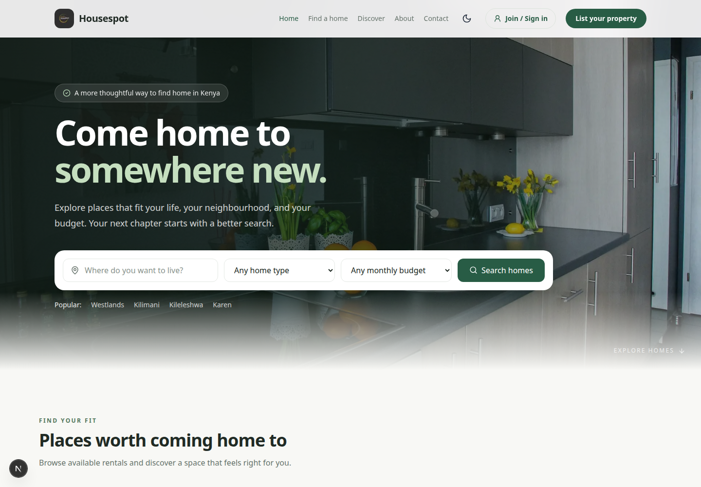
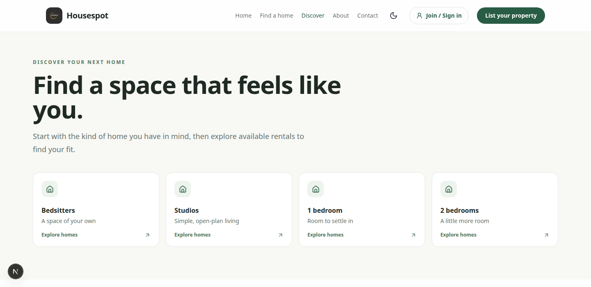

# Housepot

Housepot is a rental-home discovery platform focused on renters and property owners in Kenya. The repository includes a responsive Next.js frontend and a Django REST API for accounts, property discovery, listing moderation, and renter-owner interactions.

## Screenshots

| Home | Discover |
| --- | --- |
|  |  |

## Features

- Browse and search rental homes by neighbourhood, property type, and monthly budget.
- Discover common home types, including bedsitters, studios, and one- and two-bedroom homes.
- Responsive layouts, light and dark themes, and animated interface elements.
- Tenant sign-in and registration flows, plus a landlord property-listing flow.
- Role-aware API with JWT authentication, ownership checks, property moderation, saved listings, and inquiries.
- Supporting pages for About, FAQs, and customer support.

## Technology

| Area | Technologies |
| --- | --- |
| Frontend | Next.js 15, React 19, TypeScript, Tailwind CSS 4 |
| UI | Framer Motion, Lucide React, next-themes |
| Backend | Django 5.2, Django REST Framework, Simple JWT |
| Default database | SQLite |

## Repository layout

```text
.
├── backend/
│   ├── config/                 # Django settings and URL configuration
│   ├── manage.py
│   └── requirements.txt
├── docs/
│   └── screenshots/            # README screenshots
└── frontend/
    ├── public/                 # Property, partner, and brand assets
    └── src/
        ├── app/                # Routes and shared UI components
        └── lib/                # API and listing helpers
```

## Run locally

You will need Node.js 20 or later and Python 3.12 or later. Run the backend and frontend in separate terminals.

### 1. Start the Django backend

```bash
cd backend
python3 -m venv .venv
source .venv/bin/activate
pip install -r requirements.txt
python manage.py migrate
python manage.py runserver
```

On Windows, activate the virtual environment with `.venv\Scripts\activate`.

The Django server runs at `http://127.0.0.1:8000`. API docs are available at `/api/docs/` and the admin at `/admin/`.

### 2. Start the Next.js frontend

```bash
cd frontend
npm ci
npm run dev
```

Open `http://localhost:3000`.

The frontend uses `http://127.0.0.1:8000` as its default API origin. To point it at another compatible backend, create `frontend/.env.local`:

```env
NEXT_PUBLIC_API_URL=http://127.0.0.1:8000
```

Restart the frontend after changing environment variables.

## Application routes

| Route | Description |
| --- | --- |
| `/` | Landing page, home search, featured rentals, and location discovery |
| `/discover` | Browse by home type |
| `/listings` | Rental search and filters |
| `/about` | About Housepot |
| `/support` | Support and common questions |
| `/account` | Tenant and landlord account flows |
| `/list-property` | Landlord property submission |

## Backend

The backend exposes versioned `/api/v1/` endpoints and retains unversioned paths used by the frontend. See the [backend guide](backend/README.md) for setup, API details, environment configuration, migrations, tests, and production deployment. Frontend-specific API expectations are documented in the [frontend README](frontend/README.md).

## Development

From `frontend/`:

```bash
npm run lint
npm run build
```

Before production deployment, configure secrets and hosts securely, use PostgreSQL, configure SMTP and exact CORS origins, and run Django's deployment checks. See the backend guide for the full production checklist.

## Maintainer

[Oliver Ambrose](https://github.com/ambroseoliver)
